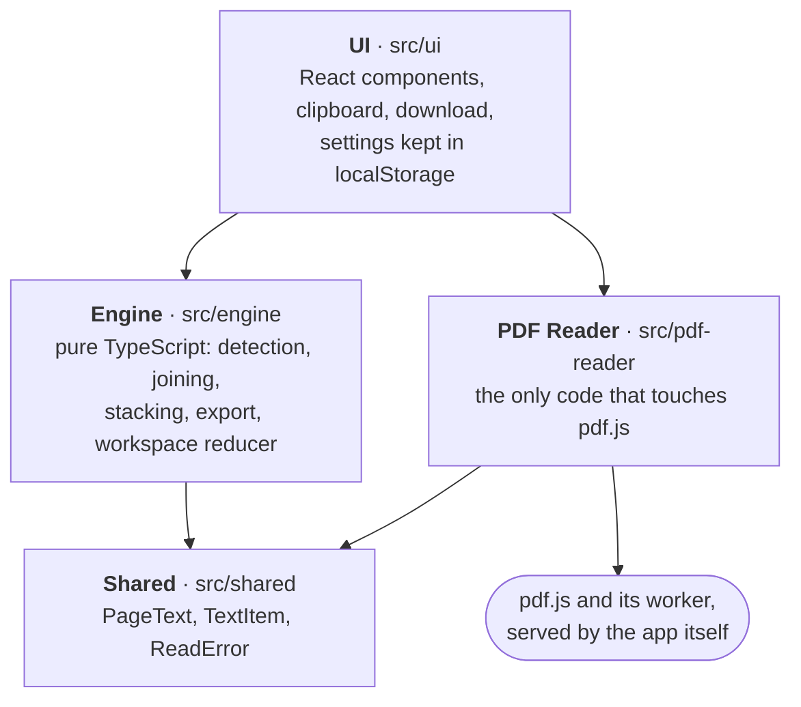
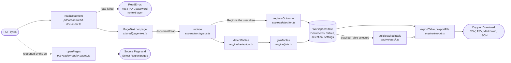
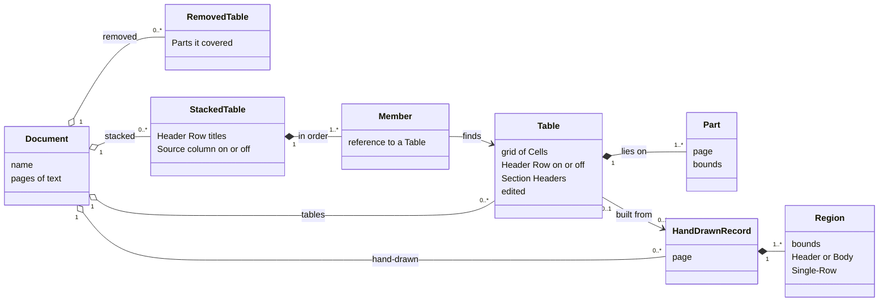

# Architecture

Three diagrams of Table Lift at module level. Words in capitals are defined in
[GLOSSARY.md](../GLOSSARY.md). The diagrams are written by hand: change them in the same pull
request as the code they describe.

## 1. Modules

The app has three modules and one shared contract. Dependencies flow one way, and ESLint fails
the build if the Engine imports pdf.js, React, the DOM or another module.

- The **Engine** and the **PDF Reader** never import each other. `PageText` in `src/shared` is the
  contract between them: the reader produces it and the Engine consumes it.
- The **Engine** has no browser dependencies, so the unit tests run it in Node.
- There is no server (ADR 0001). Nothing in the diagram leaves the browser.

## 2. A Document's path

What happens from dropping a PDF to copying a Table.

- **Reading** happens once per Document. The reader leaves rotated text out.
- **All state changes go through `reduce`.** The UI dispatches a `WorkspaceAction` and renders the
  `WorkspaceState` it gets back. The reducer is pure: it holds page text, never PDF bytes.
- **Re-detection** runs the detect and join steps again for a Document. It is triggered by Column
  Spacing, the join switch, removing or restoring a Table, Split by Page, Join Again and saving a
  Region. These would discard corrections, so the reducer first asks the user to confirm when any
  Table is edited.
- **A Stacked Table is never stored as a grid.** It is built from its Members each time it is
  shown or exported, so a Cell fixed in a Member shows in the Stacked Table.
- **Drawing pages** is a separate path (dotted). The UI remembers where each Document's PDF can be
  reached and reopens it through the reader when the Source Page or Select Region needs a picture of a page.

## 3. Kinds of Table

How the things a Document holds relate to each other.

- **Detected Table**: a Table found automatically. It is not built from a Hand-drawn record.
- **Joined Table**: a Table with more than one Part, one per consecutive page.
- **Hand-drawn Table**: a Table built from a Hand-drawn record. It lies on one page, has one or
  more Regions with at most one Header Region, and is never part of a Joined Table.
- **Removed Table**: a Detected Table the user dismissed. It is kept out of the Document's Tables
  through every re-detection until restored.
- **Stacked Table**: holds references to its Members, all in the same Document, and the Header
  Row titles they must match. A Member that stops matching, or can no longer be found, is left
  out with a notice.
